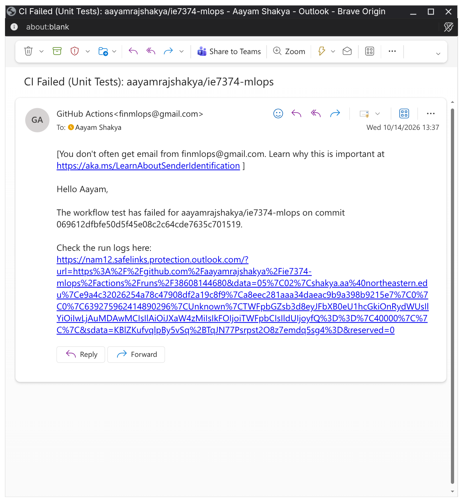

# Assignment 01: CI/CD w/ GitHub Actions

This assignment demonstrates CI workflows with Python files. I replaced the starter calculator with my own physics calculator and wrote some test cases using `pytest` and `unittest`. I also configured the GitHub Actions workflow to trigger automated email notifications via Gmail whenever tests fail.

---


## How to Run

### 1. Set up the environment
```bash
python3 -m venv <env-name>
source <env-name>/bin/activate  # I use Linux and this is how an environ is activated
pip install -r deps.txt
```

### 2. Run tests
```bash
#Pytest
pytest -v --no-header test/test_pytest.py   # -v and --no-header are the flags I used to improve readability

# Unittest
python3 -m unittest test.test_unittest
```

---

## CI failure alert screenshots

When any test fails during a GitHub Actions CI workflow run, I am notified by automated email alerts sent via Gmail.

### Pytest failure alert


### Unittest failure alert

