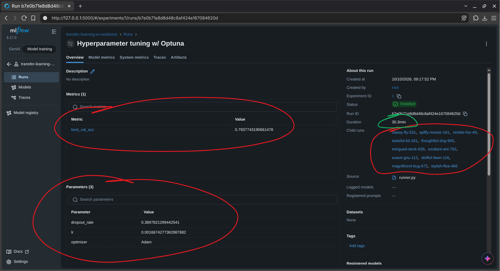
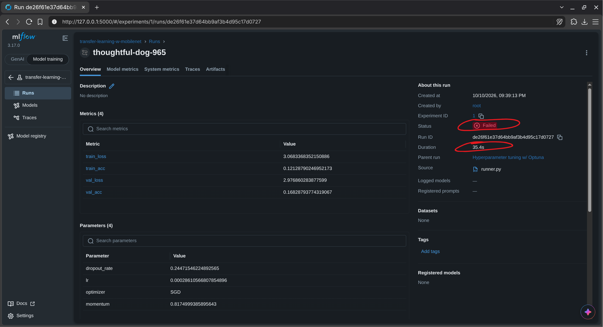
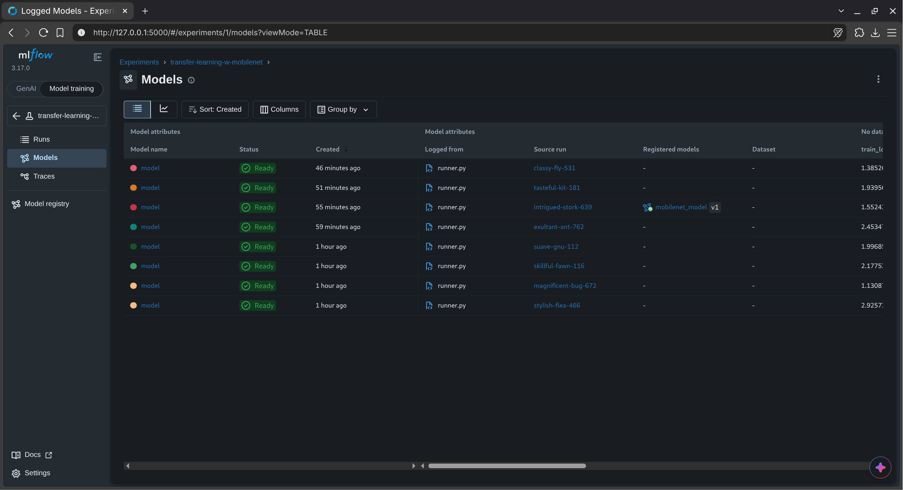
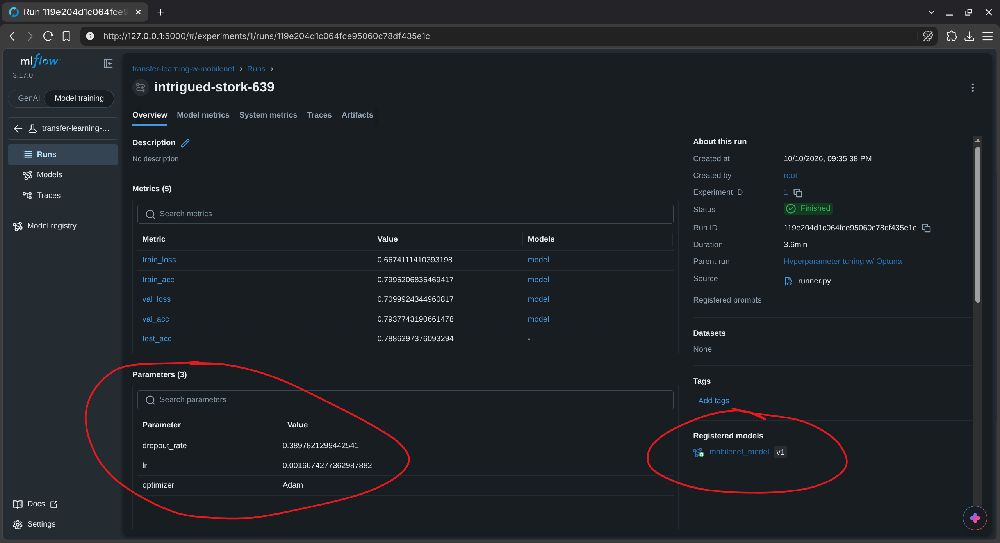
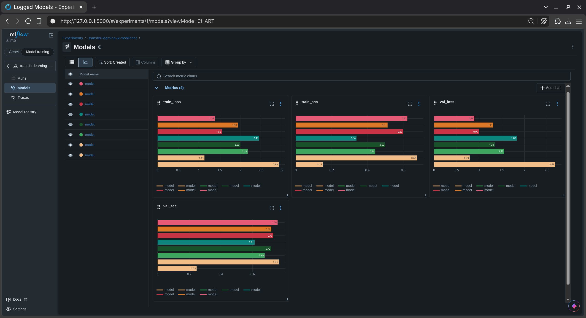
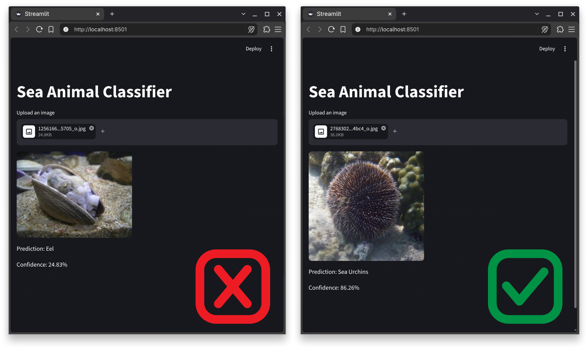

# Sea Animal Classifier

This guide explains how to set up the project, run the model pipeline (`runner.py`), and launch the Streamlit app (`gui.py`). I used the dataset in this lab from the [Kaggle Sea Animals Image Dataset](https://www.kaggle.com/datasets/vencerlanz09/sea-animals-image-dataste/data).

---

## Project Content Tree

```text
Assignment02/
├── README.md                # Project documentation and experiment analysis
├── pyproject.toml           # Project metadata and package dependencies
├── uv.lock                  # Pinned dependency lockfile
├── runner.py                # MobileNet training, tuning, and MLflow pipeline
├── gui.py                   # Streamlit web app for model inference
├── mlflow.db                # SQLite database storing MLflow experiments and model registry
├── mlruns/                  # MLflow artifact storage (models, metrics, parameters)
├── images/                  # Screenshots used in this README
└── sea_animal_dataset/      # Image dataset containing 23 sea animal class subdirectories
```

---

## Prerequisites & Environment Setup

> [!TIP]
> I exclusively use [`uv`](https://docs.astral.sh/uv/getting-started/installation/), which is superior to `pip`.

```bash
git clone https://github.com/aayamrajshakya/machine-learning-operations
cd machine-learning-operations/Assignment02
uv sync
```

---

## Running the Training Pipeline (`runner.py`)

> [!NOTE]
> Since I already ran and trained the pipeline, you can skip this step because the post-training artifacts (`mlflow.db` and `mlruns/`) are already included in the repo. However, you can still run it if you want to experiment with retraining.

```bash
uv run runner.py
```

### What happens during execution:
1. **Dataset prep:** It loads `sea_animal_dataset/` and splits it into 70% train, 15% validation, and 15% test sets.
2. **Transfer learning:** It pulls in a pretrained `MobileNetV2` model, freezes all the base layers, and attaches a new classification head with a dropout layer for the 23 classes.
3. **Hyperparameter tuning with Optuna:** It runs 11 trials to test out different learning rates, dropout rates, and optimizers (`Adam` vs `SGD` with momentum).
4. **Early pruning:** If a trial starts off performing poorly, Optuna prunes it early so we don't waste time on unpromising runs.
5. **MLflow tracking:** Every run logs its parameters, training/validation loss, and accuracy metrics step-by-step into `mlflow.db`.
6. **Model registration:** Once all trials wrap up, the best run is grabbed, saved to the MLflow model registry as `mobilenet_model`, tagged with the `@production` alias, and evaluated on the test set.

---

## Running the MLflow UI

Start the MLflow dashboard:

```bash
uv run mlflow ui
```

Open [http://localhost:5000](http://localhost:5000) in your web browser.

---

## Experiment Tracking & Evaluation

### Hyperparameter optimization study

I set up an Optuna study with 11 trials (runs) targeting `val_acc` as the primary optimization metric. Circled in this screenshot are the best validation accuracy and the set of hyperparameters that achieved it. The tuning ran for ~30 minutes, with 11 child runs in total (3 pruned/failed + 8 successful).

---

### Early pruning in action

I configured pruning in Optuna so that unpromising runs would be skipped, thus saving compute time. Here, trial `thoughtful-dog-965` was automatically terminated in just 35.4 seconds after showing poor initial metric performance.

---

### Completed runs overview

These are all the 8 Optuna runs that were successful. One of the runs, `intrigued-stork-639`, was registered as the production model after achieving the best performance.

---

### Best model run

The run `intrigued-stork-639` was identified as the best-performing, which maximized validation accuracy at ~79.4% and reached ~78.9% test accuracy. The set of hyperparameters that achieved this result is also listed.

---

### Metrics comparison

Visualization of metrics like training loss, validation loss, training accuracy, and validation accuracy side by side for all 8 successful runs.

---

## Web App (`gui.py`)

Run the Streamlit app to test the model with image uploads:

```bash
uv run streamlit run gui.py
```

Open [http://localhost:8501](http://localhost:8501) in your browser and upload an image to see the prediction and confidence score.


The final model achieves just under 80% accuracy, so while most predictions are accurate, some difficult images can still be misclassified (as shown on the left).

---

## What I Did Different

| Area | `starter.ipynb` | My `runner.py` |
| :--- | :--- | :--- |
| **Problem** | Binary classification on wine quality from tabular CSVs | Multi-class image classification on sea animals |
| **Frameworks** | scikit-learn, XGBoost | PyTorch |
| **Models** | Random forest baseline, then tuned XGBoost | Transfer learning w/ MobileNetV2 |
| **EDA** | Distribution and box plots, feature importances | None |
| **Metric** | Area under curve | Validation accuracy |
| **Tuning library** | Hyperopt | Optuna with pruning |
| **MLflow logging** | mlflow.xgboost.autolog() for the sweep, manual logging for the baseline | Manual log_params, per-epoch log_metrics, and log_model |
| **Picking the best model** | search_runs ordered by AUC | The best Optuna trial’s stored run_id |
| **Registry lifecycle** | Stages (Production, Archived) **[deprecated]** | Aliases (@production) |
| **Loading from the registry** | models:/{model_name}/production **[deprecated]** | models:/{model_name}@production |
| **Extras** | None | Sample-image inference, and a Streamlit app that loads the production model |