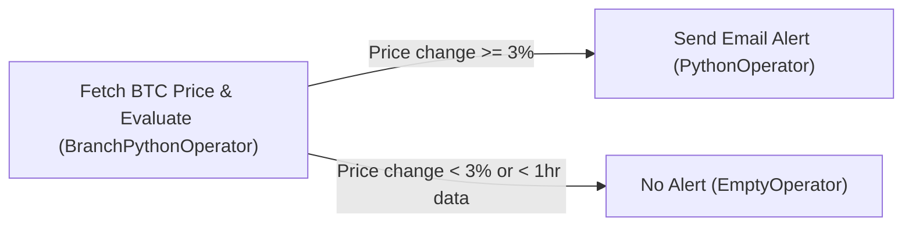
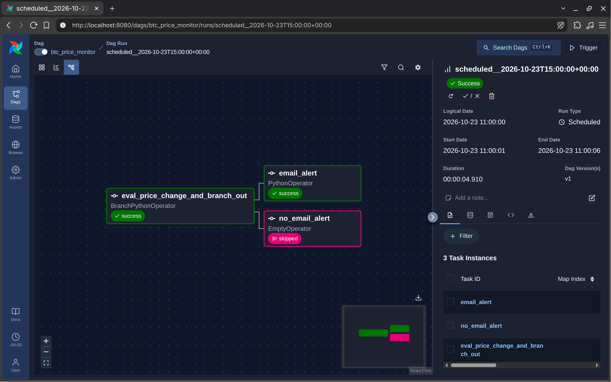
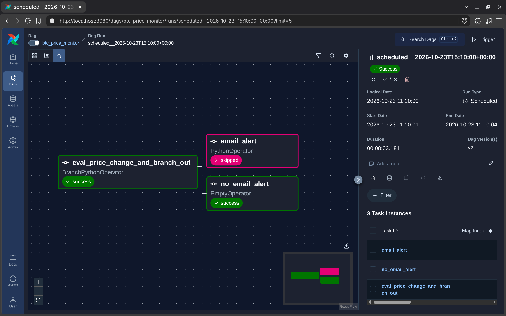
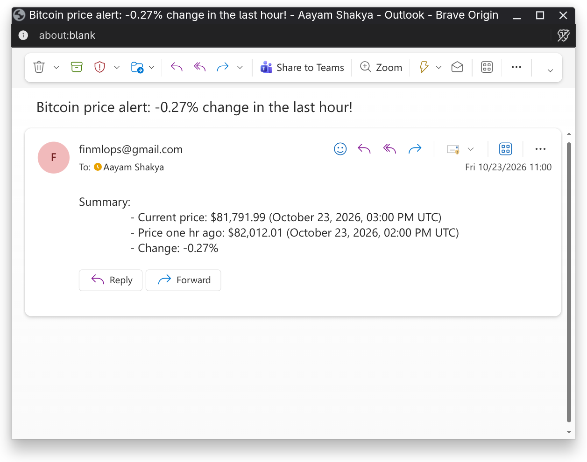
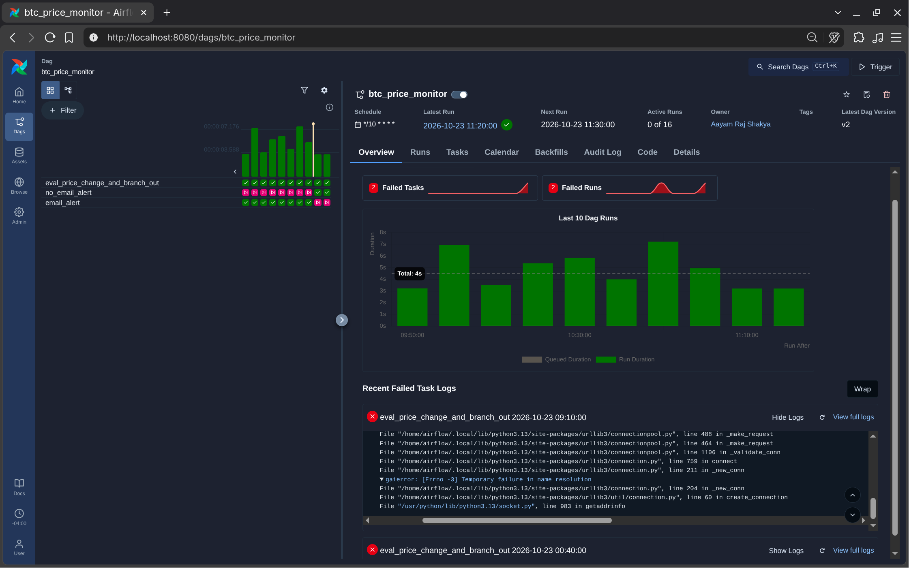

# Assignment 03: Airflow and Docker

(Bitcoin price monitor & alerting pipeline)

I built an automated pipeline using Apache Airflow and Docker that continuously tracks Bitcoin's price swings 24/7. Basically, every 10 minutes it hits FreeCryptoAPI to fetch the live BTC price in USD, saves the timestamped data locally as JSON files, and checks the last 1 hour of price history (7 intervals). If the price jumped or dropped by 3% or more compared to where it was an hour ago, it triggers an immediate email alert straight to my inbox via Gmail SMTP. If not, it skips the email and just waits for the next 10-minute tick to check again.




## Project content tree

```text
Assignment03/
├── assets/                 # screenshots showing airflow runs and email alerts
├── dag.py                  # main airflow dag that runs every 10 mins and handles the whole flow
├── src/
│   ├── config.py           # keeps all the params in one place for ease in case i need to tune them
│   ├── fetch_price.py      # uses freecryptoapi to grab live btc price and stamps it with utc time
│   ├── price_monitor.py    # does the math to check price change and sends email alert via gmail
│   ├── storage_manager.py  # saves json files to data/ and pulls them as needed
├── data/
│   └── btc_prices/         # folder where all the btc price json files get saved locally
│       └── .gitkeep        # keeps the folder tracked in git so it exists on clone
├── docker-compose.yml      # spins up airflow standalone and mounts our folders into the container
├── Dockerfile              # builds our airflow image
├── pyproject.toml          # UV thingy
├── uv.lock                 # UV thingy too
├── .python-version         # tells UV which python version to pin
├── .env.example            # template for .env
└── README.md               # this document ;)
```

---

## Setup

### Prerequisites
- Docker and Docker Compose installed on your machine
- FreeCryptoAPI token ([freecryptoapi.com](https://freecryptoapi.com/))
- Gmail account with a 16-character App Password generated for SMTP alerts

### 1. Configure environment
Copy `.env.example` to `.env` and fill in your credentials:
```bash
cp .env.example .env
```


### 2. Start Airflow via Docker
```bash
docker compose up -d --build
```

To view the Airflow UI, visit [http://localhost:8080](http://localhost:8080)

> [!NOTE]  
> - **Authentication**: I noticed that Airflow generates a different password every single time. So for the convenience of myself and the TA, I disabled authentication altogether by using the `AIRFLOW__CORE__SIMPLE_AUTH_MANAGER_ALL_ADMINS=True` config option, which disables authentication and automatically grants admin permissions to all users.
> - **Storage Choice**: I originally tried using Google Cloud Storage to store the data, but the university-provided GCP account was hard to use with lots of restrictions. Instead, I decided to save the json files locally in `data/btc_prices/` and mounted that folder into Docker. It keeps the whole setup clean, self-contained, and easy for anyone to clone and run.
> - **Auto execution**: Also, I added `restart: always` in the docker compose file so the container keeps running in the background without needing human intervention. Since the whole point of this program is to alert of price changes, I thought setting it to always run would make a lot more sense. At one point, I actually thought of setting up Google Compute Engine VM to run it 24/7, but that would've been out of scope for this assignment and would've just added unnecessary complexity. So here we are, running it locally with automatic restarts.


### 3. Test DAG manually
To trigger an immediate execution test from inside the container (`btc_price_monitor` is the `<dag_id>`):
```bash
docker compose exec airflow airflow dags test btc_price_monitor
```

> [!TIP]  
> For the purpose of testing the system for grading, please adjust the parameters `CHANGE_THRESHOLD` (e.g. `0.0001`) and `LOOKBACK_STEPS` (e.g. `2`) inside `src/config.py` since the price of Bitcoin might not swing by 3% anytime soon. You also don't need to rebuild the Docker image at all when you edit this because `./src` is mounted as a live volume into `/opt/airflow/src`, meaning any changes you save on your local machine are reflected inside the running container in real-time.


### 4. Stop containers
To stop the container and prevent it from automatically starting up on boot:
```bash
docker compose down
```

If you also want to completely delete the built Docker image to free up disk space:
```bash
docker compose down --rmi all -v
```

> [!WARNING]  
> Strictly run these commands (especially the delete command) inside the `Assignment03` directory where `docker-compose.yml` lives. Running it inside this folder ensures Docker only targets and removes the images and containers for this specific project without touching any of your other Docker work.

---

## Visual Proof

### 1. Both DAG Branches in Action
Here's how the conditional branching looks in Airflow's Graph view depending on whether the 3% threshold was met:

| Email Alert Triggered | No Alert Triggered (Skipped) |
| :---: | :---: |
|  |  |
| *I tested with a tiny threshold so the condition was met. `email_alert` ran successfully while `no_email_alert` was skipped.* | *I set the threshold back to 3% where the price didn't swing enough. `no_email_alert` succeeded while `email_alert` was skipped.* |

### 2. Email Alert Delivered
Here's the actual email alert that landed in my inbox with the live timestamps and price change summary:



### 3. DAG Overview & Run History
Here's the overall dashboard showing the schedule, run duration, and the grid history of recurring runs over time. The 2 failed runs you see on the chart happened when my internet was disconnected while the scheduler tried to make the API call to fetch the price.




