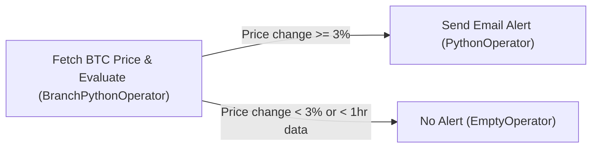

# Assignment 03: Airflow and Docker

(Bitcoin price monitor & alerting pipeline)

An automated Apache Airflow pipeline running via Docker that fetches real-time Bitcoin prices every 10 minutes, stores historical snapshots locally, and sends an email alert whenever a 3% price change occurs over a 1-hour rolling window.




## Project content tree

```text
Assignment03/
├── dag.py                  # main airflow dag that runs every 10 mins and handles the whole flow
├── src/
│   ├── config.py           # keeps all the params in one place for ease in case i need to tune them
│   ├── fetch_price.py      # uses freecryptoapi to grab live btc price and stamps it with utc time
│   ├── price_monitor.py    # does the math to check price change and sends email alert via gmail
│   ├── storage_manager.py  # saves json files to data/ and pulls them as needed
├── data/
│   └── btc_prices/         # folder where all the btc price json files get saved locally
│       └── .gitkeep        # keeps the folder tracked in git so it exists on clone
├── docker-compose.yml      # spins up airflow standalone and mounts our folders into the container
├── Dockerfile              # builds our airflow image
├── pyproject.toml          # UV thingy
├── uv.lock                 # UV thingy too
├── .python-version         # tells UV which python version to pin
├── .env.example            # template for .env
└── README.md               # this document <3 <3
```

---

## Setup

### 1. Configure environment
Copy `.env.example` to `.env` and fill in your credentials:
```bash
cp .env.example .env
```


### 2. Start Airflow via Docker
```bash
docker compose up -d --build
```

To view the Airflow UI, visit [http://localhost:8080](http://localhost:8080)

> [!NOTE]  
> I noticed that Airflow generates a different password every single time. So for the convenience of myself and the TA, I disabled authentication altogether by using the `AIRFLOW__CORE__SIMPLE_AUTH_MANAGER_ALL_ADMINS=True` config option, which disables authentication and automatically grants admin permissions to all users.


### 3. Test DAG manually
To trigger an immediate execution test from inside the container (`btc_price_monitor` is the `<dag_id>`):
```bash
docker compose exec airflow airflow dags test btc_price_monitor
```

### 4. Stop containers
```bash
docker compose down
```
