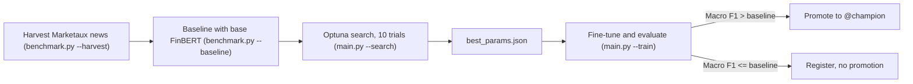
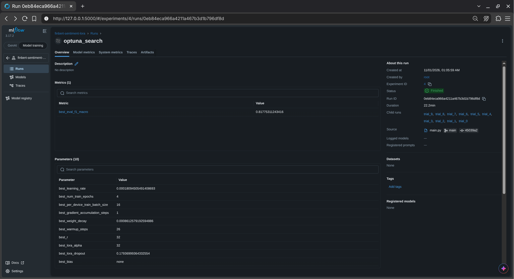
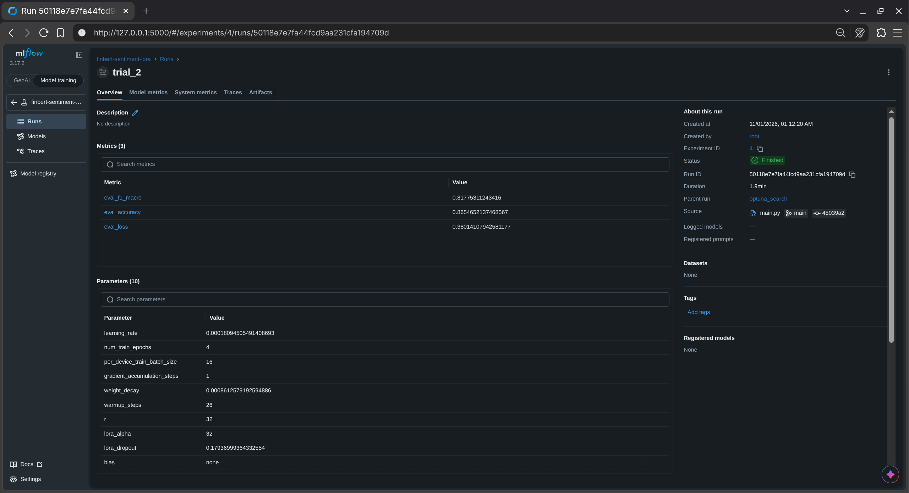
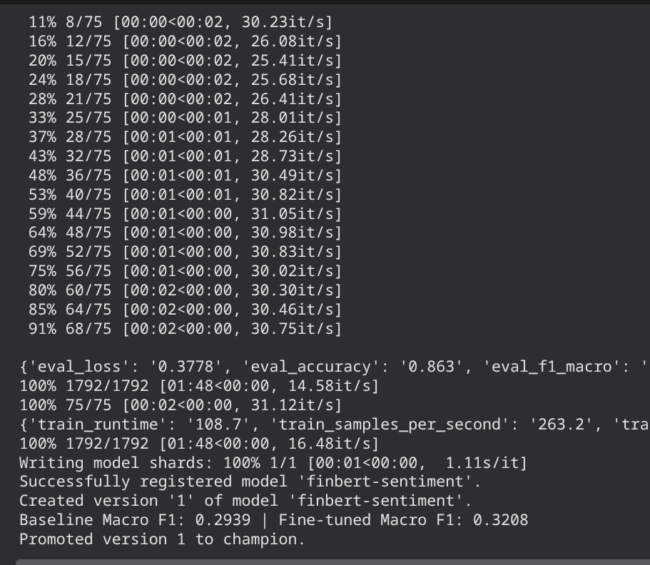
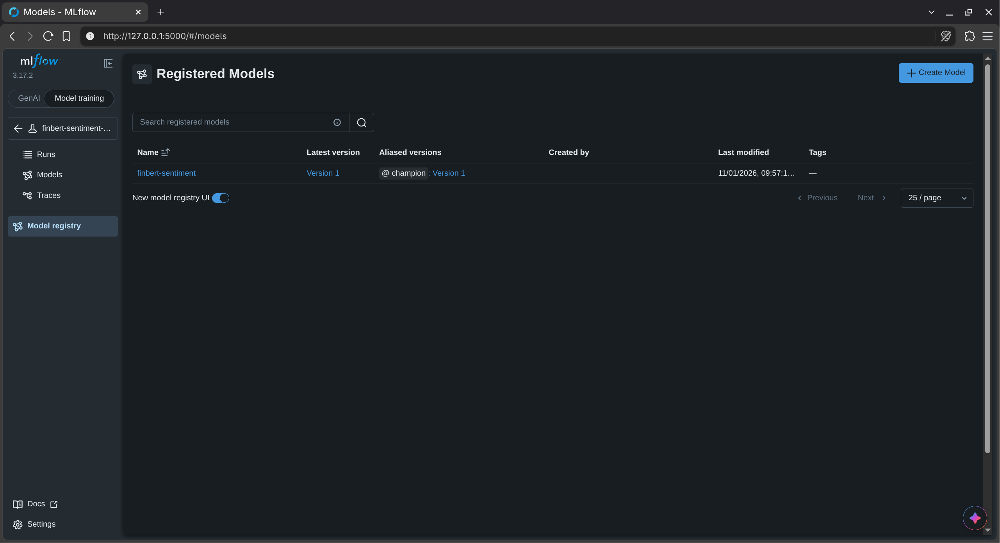
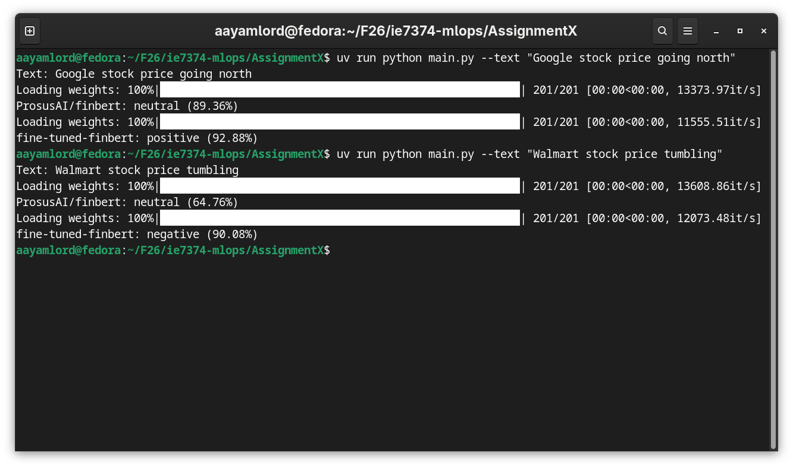

# Assignment X: LoRA Fine-Tuning (along with MLflow and Optuna)

(Financial news sentiment classifier with champion/challenger promotion)

I fine-tuned [ProsusAI/finbert](https://huggingface.co/ProsusAI/finbert) to classify financial news as positive, negative or neutral. Basically, I first grab real news about 7 big tech stocks from the Marketaux API and check how well plain FinBERT does on it, which becomes the baseline to beat. Then Optuna runs 10 LoRA fine-tuning trials with different hyperparameters, MLflow tracks every single one of them, and the winning set gets saved to `best_params.json`. Finally, FinBERT gets fine-tuned once more with those hyperparameters and tested on the same Marketaux news. If it beats the baseline, MLflow promotes it to `@champion`. If not, it still gets registered but stays unpromoted.

*(the training dataset can be swapped with `DATASET_NAME` and `LABEL_MAP` in `train.py`)*





## Project content tree

```text
AssignmentX/
├── assets/                 # screenshots used in readme
├── benchmark.py            # fetch marketaux news and evaluates base finbert to get the baseline
├── train.py                # optuna search, final fine-tuning, benchmark eval and champion promotion
├── main.py                 # cli to run the search, the training, or predict on a single headline
├── marketaux_data.parquet  # benchmark dataset: 138 news descriptions with marketaux sentiment scores
├── baseline.json           # base finbert metrics on the benchmark, aka the hurdle to beat
├── best_params.json        # best hyperparameters found by Optuna
├── mlflow.db               # mlflow tracking store and model registry with all my runs
├── pyproject.toml          # UV thingy
├── uv.lock                 # UV thingy too
├── .env.example            # template for .env
└── README.md               # this document ;)
```

Running `main.py --train` also creates these two folders, which are gitignored since the model is too big for GitHub:

```text
├── fine-tuned-finbert/         # the fine-tuned model with lora weights merged in
│   ├── config.json             # model architecture and label mapping
│   ├── model.safetensors       # model weights (~440 MB)
│   ├── tokenizer.json          # tokenizer vocabulary and rules
│   └── tokenizer_config.json   # tokenizer settings
└── mlruns/                     # copy of the model that mlflow registers
```

---

## Setup

### Prerequisites
- [uv](https://docs.astral.sh/uv/) (the project needs Python 3.14+, which uv fetches for you)
- Marketaux API token ([marketaux.com](https://www.marketaux.com/)), only needed if you want to harvest fresh news

### 1. Install dependencies
```bash
uv sync
cp .env.example .env   # then fill in MARKETAUX_API_KEY
```

### 2. Build the benchmark and baseline
```bash
uv run python benchmark.py --harvest      # or --harvest 2 for more pages
uv run python benchmark.py --baseline
```

`marketaux_data.parquet` and `baseline.json` are already included, so you can skip this step.

> [!NOTE]  
> **Zero leakage**: Marketaux gives each article a sentiment score between -1 and 1 for every ticker it mentions. The model only ever sees the article description. The score is turned into a label afterwards (above `0.15` positive, below `-0.15` negative, otherwise neutral) and is only used to grade the predictions. Base FinBERT got a macro F1 of 0.2939 on it, which is the hurdle the fine-tuned model has to clear.

### 3. Search hyperparameters
```bash
uv run python main.py --search
```

This runs 10 Optuna trials on [KaiyuanLai/twitter-financial-news-sentiment](https://huggingface.co/datasets/KaiyuanLai/twitter-financial-news-sentiment) (75% train, 25% validation). Each trial attaches a LoRA adapter to base FinBERT and fine-tunes it with a different combination of learning rate, epochs, batch size, gradient accumulation, weight decay, warmup steps and LoRA `r`, `lora_alpha`, `lora_dropout` and `bias`. Every trial is logged in MLflow as a nested run under one `optuna_search` run, and the best hyperparameters are saved to `best_params.json`.

> [!TIP]  
> Since `best_params.json` is already committed, you can also skip straight to step 4.

### 4. Fine-tune, evaluate and promote
```bash
uv run python main.py --train
```

This fine-tunes base FinBERT once more with `best_params.json`, merges the LoRA weights into the base model and saves it to `fine-tuned-finbert/`. Then it evaluates the model on the Marketaux benchmark exactly the same way as the baseline, registers it in MLflow as a new version of `finbert-sentiment`, and gives it the `@champion` alias only if its macro F1 beats `baseline.json`.

> [!NOTE]  
> **Merging LoRA weights**: Instead of saving the LoRA adapter separately, I merge it straight into the base weights with `merge_and_unload()`. That way `fine-tuned-finbert/` is a regular standalone model that loads with plain `transformers`, with no `peft` needed at inference time.

### 5. Predict on a headline
```bash
uv run python main.py --text "Walmart stock price tumbling"
```

This prints the prediction from base FinBERT and, if `fine-tuned-finbert/` exists, the fine-tuned model right below it so you can compare the two.

### 6. Open the MLflow UI
```bash
uv run mlflow ui --backend-store-uri sqlite:///mlflow.db
```

To view the trials, the fine-tuning run and the model registry, visit [http://localhost:5000](http://localhost:5000)

---

## Visuals

### 1. Optuna search tracked in MLflow
Here's the parent search run next to the trial that won:

| Optuna search run | Best trial |
| :---: | :---: |
|  |  |
| *The `optuna_search` run with its 10 nested trials, the best validation macro F1 (0.8178) and the winning hyperparameters as `best_XYZ` params.* | *`trial_2` was the winner trial.* |

### 2. Fine-tuning and promotion
This is the end of the `main.py --train` run on Colab. The fine-tuned model scored 0.3208 macro F1 on the Marketaux benchmark against the baseline's 0.2939, so version 1 got promoted to champion:



### 3. Model registry
And here's the promotion showing up in the MLflow model registry, with version 1 of `finbert-sentiment` carrying the `@champion` alias:



### 4. Base vs fine-tuned predictions
Finally, a quick sanity check with `main.py --text`. Base FinBERT called both headlines neutral, while the fine-tuned model read them as positive and negative, which is what I'd expect from the fine-tuned model:


